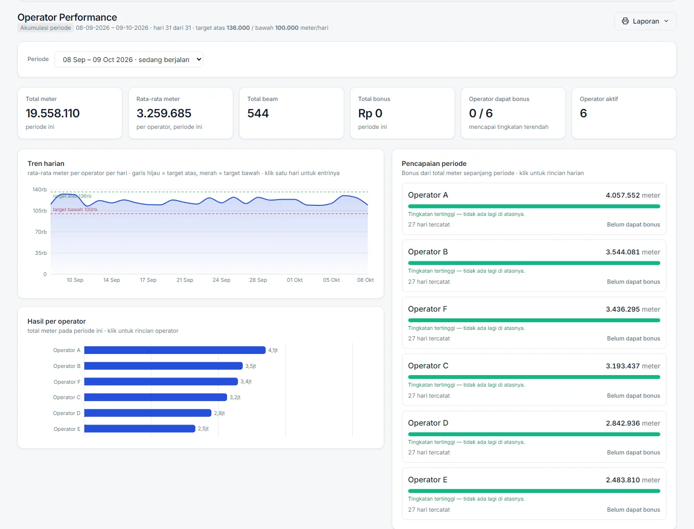
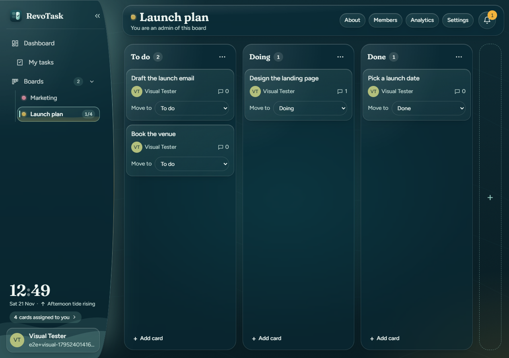
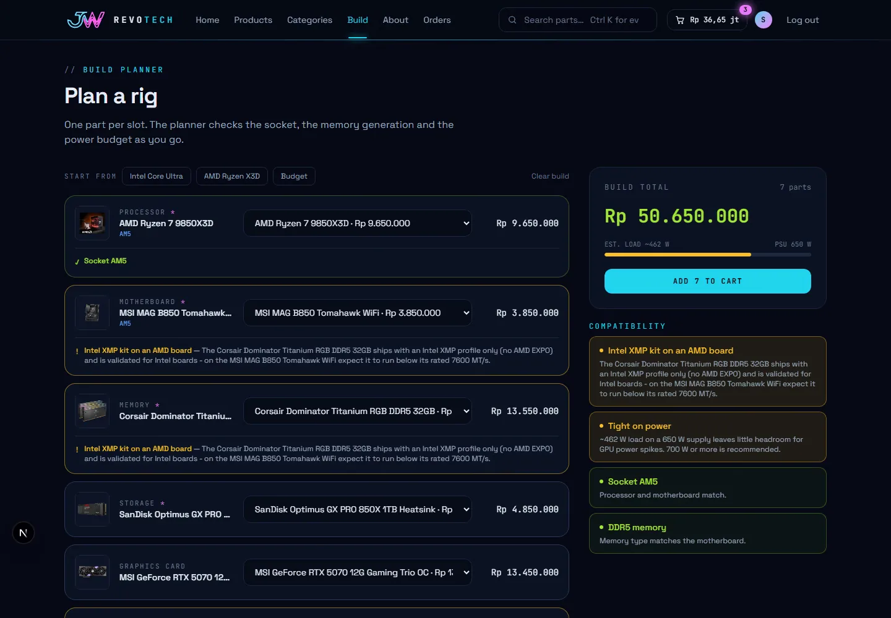
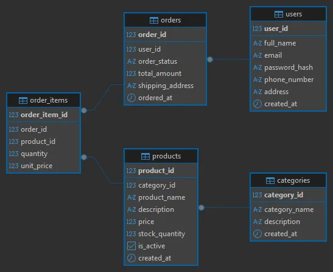
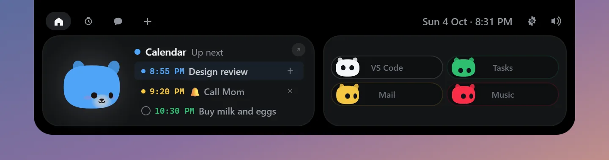

  
  
  

> *I am confident that operations will run smoothly when supported by a well-designed system.
> A strong system is built on the wisdom that comes from both experience and knowledge.*

I spent ten years running operations — hotel assets, HR, a regional sales office, and the facilities of a whole school —
before I started building the software those operations run on. That order matters: I design systems from the floor up,
for the people who use them every shift.

Today I audit and simplify the business systems of **PT Heksatex Indah**, a textile manufacturer, and build the tools
that replace its paperwork.

## How I work

<table>
  <tr>
    <th width="33%" align="left">Audit</th>
    <th width="33%" align="left">Analyze</th>
    <th width="33%" align="left">Build</th>
  </tr>
  <tr valign="top">
    <td>Walk the floor and read the data. CCTV audits, asset IDs simplified, and yarn traced lot by lot from warehouse receipt to daily production report.</td>
    <td>Turn what I find into a model. Databases for admissions, finance, inventory, and medical records, kept in sync so every record exists once.</td>
    <td>Ship the tool and keep it tested. Full-stack apps in Flask, React, and PostgreSQL, backed by more than 1,500 automated tests.</td>
  </tr>
</table>

## The thread so far

## Selected work

<table>
  <tr valign="top">
    <td width="46%"></td>
    <td>
      <h3>HI Support</h3>
      
The internal operations platform at PT Heksatex Indah, used by yarn preparation, transport and logistics, and security and the front office.

      <ul>
        <li>Operator bonuses calculated straight from ERP production reports, replacing manual spreadsheets.</li>
        <li>An executive dashboard with month- and year-to-date KPIs and drill-down on every chart.</li>
        <li>Fleet booking, visitor registration with on-device ID-card OCR, role-based access, and a full audit log.</li>
      </ul>
      
      
      
      
       Private, in production. The screenshot uses demo data.
    </td>
  </tr>
  <tr valign="top">
    <td width="46%"></td>
    <td>
      <h3>RevoTask</h3>
      
A Trello-style team task board with a sea-glass interface: boards with a goal and a deadline, drag-and-drop cards, rich-text descriptions, comments, notifications, and analytics for board admins.

      <ul>
        <li>A Flask REST API on Render with Supabase PostgreSQL, and a Next.js app on Vercel.</li>
        <li>Built spec-first with Kiro: 53 requirements, 33 coding guidelines committed before any code, and 28 documented refinements.</li>
        <li>Nearly 300 automated tests across pytest, Jest, and Playwright, including property-based tests and accessibility scans.</li>
      </ul>
      
      
       Try it with the demo account listed in the repository.
    </td>
  </tr>
  <tr valign="top">
    <td width="46%"></td>
    <td>
      <h3>RevoTech Storefront</h3>
      
A Next.js shop for PC parts priced in rupiah: live search, cart and checkout, order tracking, and a build planner that checks the parts fit together.

      <ul>
        <li>Admin dashboard for products, categories, orders, revenue, and stock.</li>
        <li>Three roles, enforced in the interface and on every write endpoint.</li>
        <li>81 Playwright tests against both an in-memory store and PostgreSQL.</li>
      </ul>
      
      
    </td>
  </tr>
  <tr valign="top">
    <td width="46%"></td>
    <td>
      <h3>RevoShop API</h3>
      
The e-commerce backend behind RevoTech: a PostgreSQL schema for users, categories, products, and orders, with a Flask and SQLAlchemy API and versioned migrations.

      
    </td>
  </tr>
  <tr valign="top">
    <td width="46%"></td>
    <td>
      <h3>Qookaa</h3>
      
A small quokka that lives at the top of the screen: timers, calendar and mail reminders, tasks, music with synced lyrics, and chat with the major AI models. It also shows AI coding agents working live.

      
      
      
    </td>
  </tr>
</table>

<b>More projects</b>

 

- **Textile production data** — reconciled warehouse, warping, and daily production records by yarn lot to estimate leftover yarn, and moved production spreadsheets into PostgreSQL.
- **School operations apps** — receptionist, admission, finance, inventory, extracurricular, guestbook, and budget systems for Cahaya Bangsa Classical School, each emailing parents and staff automatically.
- **School newsletter** — a bilingual one-page newsletter in HTML, CSS, and JavaScript, with a section and calendar for each school division.
- **Admission confirmation email** — an email-safe HTML letter filled in from the admission form, with Outlook fallbacks.
- **Photo gallery** — a responsive masonry gallery with a lightbox.

## Toolbox

<table>
  <tr>
    <th align="left" valign="top">Build</th>
    <td>
      
      
      
      
      
      
      
      
      
      
    </td>
  </tr>
  <tr>
    <th align="left" valign="top">Data</th>
    <td>
      
      
      
      
      
      
      
    </td>
  </tr>
  <tr>
    <th align="left" valign="top">Ship &amp; test</th>
    <td>
      
      
      
      
      
      
      
      
      
    </td>
  </tr>
  <tr>
    <th align="left" valign="top">Operations</th>
    <td>
      Workflow and SOP design, asset and inventory management, budgeting and cost control, facilities, safety and crisis management, and occupational health and safety (K3).
    </td>
  </tr>
</table>

## On GitHub

  
  

  

  

## Now

- Auditing and simplifying business systems at PT Heksatex Indah.
- Finishing the **Full-Stack Software Engineering** program at RevoU (June – November 2026).

<b>Certifications</b>

 

| Certification | Issuer | Year |
|---|---|---|
| Software Engineer | HackerRank | 2026 |
| Basic Software Engineering | RevoU | 2026 |
| Digital Marketing | RevoU | 2026 |
| Data Analytics | RevoU | 2023 |
| Occupational Health & Safety Management (K3) | SRZ Consultrain | 2022 |
| General Affairs in Human Resources | HRIndo Society | 2022 |
| Basic Life Support (BLS) | Cahaya Kawaluyan Hospital | 2022 |
| Child Protection | CSAWA | 2022 |

---

  <a href="https://jimwilliam.vercel.app"><b>See the full portfolio</b></a> &nbsp;or&nbsp; <a href="https://www.linkedin.com/in/jim-william"><b>connect on LinkedIn</b></a>
    
  This repository also holds the source of my portfolio site — see <a href="DEVELOPMENT.md">DEVELOPMENT.md</a>.

